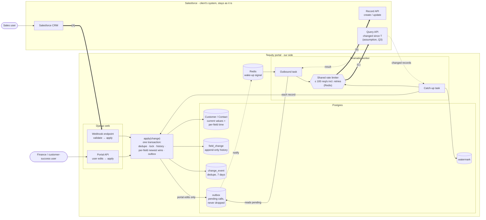

# Architecture

Status: **agreed direction.** Rules decided so far are recorded in [Design](Design) §7–9. Numbers
marked *assumption* come from open questions in [Design](Design) §1.

Brief: [`docs/Round1.html`](https://github.com/hellosrijan/sync-data/blob/main/docs/Round1.html).

| Constraint (from the brief) | Value |
|---|---|
| Records | 5 million customers and contacts |
| Sync while both sides are up | ≤ 30 s worst case |
| Calls we make to the Salesforce API | ≤ 100 requests/sec, **retries included** |
| Webhooks Salesforce sends us | Outside that cap |
| Outage | Salesforce API unreachable for 6 hours. Webhooks sent in that window may never arrive. Pending calls survive our restarts. |

## The three paths

| Path | Direction | Trigger | Counts against the cap? |
|---|---|---|---|
| **A. Webhook** | Salesforce → portal | A record changes in Salesforce. Salesforce calls our endpoint. | No |
| **B. Outbound** | Portal → Salesforce | A portal user saves an edit. The worker calls the record API (create / update). | Yes |
| **C. Catch-up** | Portal pulls from Salesforce | Salesforce recovers after an outage, and a safety-net timer runs every 5 min. The worker asks what changed since the watermark. | Yes |

A and B are the brief's own paths. C exists because webhooks missed during an outage may never
arrive (the brief's words).

## Diagram



| Arrow | Meaning |
|---|---|
| **(A)** | Webhook over HTTPS. Salesforce calls us. Outside the cap. |
| **(B)** | Create / update over HTTPS. We call the record API. Counts against the cap. |
| **(C)** | "Changed since watermark" query over HTTPS. Counts against the cap. |
| result | Accepted → mark the outbox row sent; on a create, store the Salesforce ID. Unreachable → retry with backoff capped at 60 s. 429 → the whole limiter slows down. Bad data → `needs_review`. Full rules: [Sending and retries](#sending-and-retries-path-b). |
| dotted | Signals and responses, not data writes |

Thick arrows (A, B, C) are requests that cross the public internet over HTTPS, which is the only
path between the two systems. Their dotted replies return over the same connections. Everything
else stays inside our network.

## How to read the diagram

Here's the diagram walked through from the outside in: the two systems, our components, the
three data paths, and then the brief's own scenario traced through it.

### 1. The two big boxes

The diagram has two yellow regions, and the gap between them is the public internet.

- **Top box: Salesforce.** This is the client's system. We can't change it ("stays as it is"). It has three parts:
  - **Salesforce CRM:** the app where sales users edit records. It has its own database.
  - **Record API:** where we create and update records in Salesforce.
  - **Query API:** where we ask "which records changed since time T?". The brief doesn't promise this exists, so it's labelled *assumption, Q3*.
- **Bottom box: the Tequity portal.** Everything here is ours.

Only the three **thick arrows, (A), (B) and (C)**, carry requests between the boxes, all over HTTPS. Their replies (the dotted *result* and *changed records* arrows) come back over the same connections. That's the brief's rule: "HTTPS is the only path between them." Everything else in the bottom box stays on our own network.

The two people on the left mark the brief's other rule: a **sales user** only touches Salesforce, and a **finance / customer-success user** only touches the portal. Neither ever uses the other system. Every bit of syncing between them is our job.

### 2. Inside the portal

Inside the portal box there are three smaller boxes, plus Redis and `apply()` sitting loose.

**Django web**, the part that receives requests:
- **Webhook endpoint:** Salesforce calls this when a record changes. It validates the request (is it really from Salesforce, is the payload well-formed), then hands it to `apply()`.
- **Portal API:** finance users' edits arrive here. It also hands each edit to `apply()`.

**`apply(change)`**, the large box in the middle. Every change enters the database through this one function, whether it came from a webhook, a portal user or a catch-up run. It runs in a single database transaction, so either all its writes happen or none do. It's drawn as one box because having one implementation is the point: duplicates, ordering, history and the loop rule are all decided in one place. Its steps are in section 4.

**Postgres**, our database. It holds five things:

| Table | What it holds | Why it exists |
|---|---|---|
| **Customer / Contact** | The current value of every field, plus *when* each field was last set, by which side, and **the last value we synced from Salesforce** | The per-field time tells us whether an incoming change is newer. The last Salesforce value lets us correctly tell which fields changed whether a webhook carries only the changed fields (the assumed case) or the whole record. |
| **field_change** | Every change ever made: field, value, who, when, from which side, and whether it became current | The brief's history requirement. Rows are only added, never changed. |
| **change_event** | The ID of every change we've seen, kept 7 days | Duplicate detection: a second copy of an ID is ignored |
| **outbox** | Portal edits waiting to be sent to Salesforce, with their state (`pending`, `sent`, `needs_review`), attempts and next retry time | The pending work. It's on disk, so it survives restarts, and it's never dropped. |
| **watermark** | How far the last catch-up got | So the next catch-up only asks for what's new |

**Redis**, mainly a doorbell. When a row lands in the outbox, Redis tells the worker "there's work". If Redis lost that message, no work would be lost, because the outbox in Postgres still holds the row. That's why it's labelled *wake-up signal* and not *queue*. Redis also holds the shared limiter count and Dramatiq's own task messages, but no pending calls.

**Dramatiq worker**, the background process that talks to Salesforce. It has three parts:
- **Outbound task:** sends pending outbox rows to Salesforce.
- **Catch-up task:** asks Salesforce what changed, after an outage and every 5 minutes as a safety net.
- **Shared rate limiter**, the hexagon. *Every* call we make to Salesforce goes through it: sends, retries and catch-up queries. It keeps the total at or under the run rate of 90 req/s, below the 100 req/s cap (Q10). It lives in Redis so that all worker threads and processes share one count. Webhooks don't pass through it, because the brief says they don't count.

### 3. The three paths

#### Path (A): Salesforce → portal (webhook)

*Sales user → Salesforce CRM ⇒(A)⇒ webhook endpoint → `apply()` → tables*

1. A sales user changes a phone number in Salesforce.
2. Salesforce sends a webhook to our endpoint over HTTPS. It carries `eventId`, `recordId`, `objectType`, `occurredAt`, `changedBy` and `changedFields`.
3. The endpoint checks the DRF token (401 if wrong), validates the payload (400 if malformed), works out which fields actually changed, and calls `apply()`. Nothing is stored before these checks pass.
4. `apply()` updates the current phone (if this change is the newest), writes a history row, and records the event ID.
5. **No arrow goes from this path to the outbox.** That's the sync-loop rule: anything that came *from* Salesforce is never sent *back* to Salesforce.

It's fast (milliseconds), and it doesn't count against the rate limit.

#### Path (B): portal → Salesforce (outbound)

*Finance user → Portal API → `apply()` → outbox ··notify··› Redis → Outbound task → rate limiter ⇒(B)⇒ Record API*

1. A finance user sets city = Noida.
2. The Portal API calls `apply()`, which saves the city, writes a history row, **and in the same transaction** adds an outbox row saying "the city on this record needs sending to Salesforce". Because it's one transaction, we can never end up with the edit saved but the send forgotten, or the reverse.
3. The outbox nudges Redis (dotted *notify*), and Redis wakes the outbound task.
4. The outbound task claims the pending row (*reads pending*), reads the city's **current** value from the record, and asks the rate limiter for permission. Sending the current value rather than the edit means an older edit can never overwrite a newer one in Salesforce.
5. The limiter lets it through, and the task calls the Record API (thick arrow **B**). A create is sent as an upsert carrying our record ID, so a retry can't create a duplicate (assumption Q13).
6. The dotted **result** arrow is Salesforce's answer:
   - **Accepted:** mark the outbox row sent. On a create, also store the new Salesforce ID.
   - **Unreachable, timeout or 5xx:** keep the row and retry with backoff (1, 2, 4, 8 s…, never more than 60 s).
   - **429 "slow down":** keep the row, and slow the whole limiter down.
   - **Rejected for bad data:** move the row to `needs_review` and raise an alert. It's never dropped.

   Every retry goes back through the limiter, so retries count toward the cap. Full rules are in [Sending and retries](#sending-and-retries-path-b).

This is the only path that writes to Salesforce, and only portal edits feed it (the *portal edits only* label on the arrow into the outbox).

#### Path (C): catch-up (portal pulls from Salesforce)

*Catch-up task → rate limiter ⇒(C)⇒ Query API ··changed records··› Catch-up task → `apply()` (each record) + watermark*

1. It's triggered when Salesforce comes back after an outage, and every 5 minutes as a safety net.
2. The task asks the Query API for records changed since the watermark (thick arrow **C**). This call also goes through the limiter.
3. Salesforce returns the changed records (dotted *changed records*), up to about 2,000 per call.
4. Each record goes through **the same `apply()`** as a webhook (*each record*). So if we'd already received a change by webhook, its values match what we last synced, no field counts as changed, and nothing new is written. (The two paths use different event IDs, so this comparison is what catches the copy.)
5. The task moves the watermark forward.

This path exists because of one line in the brief: webhooks Salesforce tried to send during the outage "may never arrive". Without (C), sales-side edits made during those 6 hours would be lost for good.

### 4. What happens inside `apply()`

The box says *dedupe · lock · history · per-field newest wins · outbox*. In order:

1. **Dedupe:** try to record the change's ID in a nested savepoint (`transaction.atomic()`). If it's already there, this is a duplicate, so return `duplicate` without poisoning the transaction and stop (no changes made).
2. **Lock** the record (`SELECT … FOR UPDATE`), creating it if it's a new Salesforce record (`get_or_create`). An unknown portal pk or an unknown Salesforce update raises `UnknownRecord` and rolls back (Q16).
3. **Echo check:** if the change came from Salesforce or catch-up and its actor is *our integration user* (`settings.SALESFORCE_INTEGRATION_USER`), it's our own update coming back: record history as `echo`, apply nothing to the record, and stop (Q15). An echo never creates a record (Q17).
4. **For each changed field** (filtered by comparing against `field_meta.sf_value` for Salesforce and catch-up):
   - always write a `field_change` history row;
   - if the change is newer than that field's stored time, make it the current value and update `field_meta` (`at`, `source`, `by`, and `sf_value` on Salesforce changes);
   - if it's older, it stays in history only, marked *superseded*;
   - on an exact tie, Salesforce wins.
5. **Audit columns:** set `created_by` on creation; set `updated_by` on every change that applied at least one field.
6. **Outbox:** if the change came from the portal and applied at least one field, upsert the single pending outbox row, merging the fields as a sorted union. A pending `create` stays `create` on merge (Q18). Salesforce and catch-up changes never write to outbox.
7. **Commit**, so all of the above happens or none of it does.

### 5. The brief's scenario, traced through the diagram

| Step | Path | What happens |
|---|---|---|
| Sales creates a customer in Salesforce | **A** | The webhook creates the record; one history row per field |
| Finance corrects the billing city to Noida | **B** | `apply()` saves the city and adds an outbox row; the worker sends it to Salesforce through the limiter |
| Salesforce echoes our city change back as a webhook | **A** | Echo check: `changedBy` is our integration user, so it's recorded but not re-applied, and nothing goes back out. No loop. |
| Sales changes the phone | **A** | Only the phone is applied. The city is a different field, so *"the city the finance person set should still be there"* ✅ |
| Salesforce sends that phone webhook twice | **A** | The second copy hits the same event ID, so nothing happens |
| A late, older phone change arrives | **A** | History row saved as superseded; the current phone stays as it is |
| "Who changed the phone, who changed the city?" | — | Read from **field_change**: every edit, actor and time, including superseded ones |

### 6. During and after a 6-hour outage

- **While Salesforce is down:**
  - Portal edits keep working, because path B's first half (`apply()` → outbox) doesn't need Salesforce. Outbox rows pile up safely in Postgres.
  - The outbound task's calls fail; the rows stay pending, and a cheap test call every ~10 s checks whether Salesforce is back.
  - Webhooks (A) stop arriving.
- **When Salesforce comes back:**
  1. **Catch-up (C) first.** Pull what sales users changed during the outage and apply it. Conflicts on the same field are settled before we send anything.
  2. **Then drain the outbox (B)** as fast as the limiter allows. At the assumed 5 portal edits per second: 108,000 pending calls ÷ (90 − 5) per second ≈ **21 minutes**.
- **If our own process restarts during the outage:** nothing is lost. The pending work is in Postgres, not in memory or Redis.

### 7. Reading the arrow styles

| Style | Meaning |
|---|---|
| **Thick (A, B, C)** | Crosses the public internet over HTTPS. B and C count against the 100 req/s cap; A doesn't. |
| **Thin solid** | Data moving inside our system (writes, reads, hand-offs) |
| **Dotted** | Signals and replies: *notify*, *result*, *changed records* |

## `apply(change)`: one function for every inbound change

Webhooks (A), portal saves and catch-up results (C) all go through `apply()`. One
implementation covers duplicates, ordering, history and the loop rule.

```
change = { source: salesforce | catch-up | portal, event_id, object_type, record_ref, occurred_at, actor, fields{...}, operation }

one Postgres transaction:
 1. Dedupe     INSERT event_id INTO change_event in savepoint (unique). Conflict → duplicate: return OK.
 2. Lock       SELECT record ... FOR UPDATE (creates record on salesforce create; raises UnknownRecord on missing update/portal record)
 3. Echo       source in (salesforce, catch-up) and actor = settings.SALESFORCE_INTEGRATION_USER →
               record history with status echo, apply nothing, stop (echo never creates a record).
 4. Per field  filter changed fields against field_meta.sf_value for salesforce/catch-up
               always INSERT field_change(record, field, value, actor, occurred_at, source, status)
               occurred_at > field's stored time → becomes current (applied), updates field_meta
               otherwise → stays in history only (superseded)
               exact tie → Salesforce wins
 5. Audit      created_by on create; updated_by on applied change
 6. Outbox     source = portal and a field was applied → upsert pending outbox row (merge fields; pending create stays create)
               source in (salesforce, catch-up) → never
 7. COMMIT
```

Where the inputs come from:

| Input | Webhook (A) | Portal save | Catch-up (C) |
|---|---|---|---|
| `event_id` | `eventId` | New UUID | `record_id` + Salesforce modified time |
| `occurred_at` | `occurredAt` | Our server clock when the save arrives | Salesforce modified time (record level) |
| `actor` | `changedBy` | The logged-in portal user | Salesforce "last modified by" |
| `fields` | Fields whose value differs from the last value we synced from Salesforce (the webhook carries only the changed fields, assumption Q2 — but this comparison holds even if it ever carried the whole record instead) | The fields in the form | Same comparison as a webhook |

## Sending and retries (path B)

Decided ([Design](Design) §6, Q7). The **outbox** drives sending and retries; Dramatiq's own
retries are turned off for the outbound task.

```
pending ──send──► sent ✓
   ▲  │
   │  ├─ unreachable / timeout / 5xx ─► pending again, next_attempt_at = now + backoff
   │  ├─ 429 slow down ───────────────► pending again, at Retry-After; the whole limiter slows
   │  └─ 400-type rejection ──────────► needs_review   (never dropped, alert raised)
   └── a person fixes it and requeues ◄─┘
```

| Salesforce's answer | Action |
|---|---|
| Accepted | `sent`. On a create, store the Salesforce ID. |
| Unreachable, timeout, 5xx | Retry at 1, 2, 4, 8 s…, capped at 60 s. Four quick retries take 15 s, inside the 30 s target. |
| 429 slow down | Pause the shared limiter until `Retry-After`, halve its rate, then climb back by 5 req/s every 30 s to 90 |
| 400-type rejection | `needs_review` and an alert. Never dropped. |
| 401 / 403 | Stop all sending and page someone: our credentials are wrong |

- **Outage detection:** after 5 consecutive unreachable failures, Salesforce is marked *down*.
  Sending stops and a probe runs every 10 s. When it succeeds, catch-up runs, then every pending
  row is due at once.
- **We send the current value, not the edit.** The worker reads the record's current values for
  the changed fields at send time. Pending edits to one record collapse into one call, and an
  update sent twice is harmless.
- **Workers claim rows** with `SELECT … FOR UPDATE SKIP LOCKED` and a lease (`lease_until`). If a
  worker dies mid-call, the lease runs out and another worker sends the row again.
- **Creates are upserts by external ID** (assumption Q13). Our record ID goes with the create, so a
  retry after a timeout matches the existing record instead of making a duplicate.
- **Wake-up:** Redis nudges the outbound task, and a timer task every 5 s backs up a lost nudge.
  Redis holds no pending calls, so losing its messages loses no work (Q8 closed).

## How the brief's rules are met

| Rule | Mechanism |
|---|---|
| Duplicate webhook | `change_event.event_id` is unique, so a repeat is a no-op. IDs are kept 7 days. |
| Out-of-order change | Per-field `occurred_at` comparison. The older change is kept in history but isn't current. |
| Different fields edited at once | The comparison is per field, so both edits survive |
| Same field edited at once | The newest `occurred_at` is current, and every edit stays in history. Two portal users: last save wins, with no warning (Q4). |
| History: who, what, when | `field_change` is written explicitly in `apply()` on every path, including superseded edits and bulk catch-up. It isn't a Django signal, because signals miss superseded edits and bulk writes. |
| Sync loop | Only portal edits create outbox rows. Our echo (actor = integration user) is never applied. |
| Pending calls survive restarts | The outbox row commits in the same transaction as the edit. Redis holds no pending calls, so losing a wake-up loses no work. |
| Slow down | A 429 pauses the shared limiter until `Retry-After`, halves its rate, then climbs back by 5 req/s every 30 s. The row stays pending. |
| Unreachable | Retry with backoff capped at 60 s. After 5 consecutive failures Salesforce is marked down, and a probe checks every 10 s. Nothing is dropped (Q9). |
| Rejected (bad data) | `needs_review` plus an alert; a person fixes and requeues it. Never dropped (Q9). |
| Webhooks missed in the outage | Catch-up (C), triggered by recovery and every 5 min |

## After an outage

1. Outbound calls start failing. After 5 consecutive failures Salesforce is marked down: sending
   stops, outbox rows stay pending, and a probe checks every 10 s whether Salesforce is back.
2. The probe succeeds, so Salesforce is back.
3. **Catch-up first.** Pull what changed in Salesforce since the watermark (minus a few minutes
   of overlap) and apply each record. Same-field conflicts are settled before we send anything.
4. **Then drain the outbox** at the full run rate. Edits to the same record are merged into one
   call.

## Scale check

*Assumptions* (recorded in [Design](Design) §1):
- **Q1:** peak 10 edits/s, split 5 Salesforce / 5 portal; working-hours average 3.5/s; quiet hour 0.2/s.
- **Q10:** run rate R = 90 req/s, leaving 10 for retries, probes and catch-up.
- **Q3:** the query API returns about 2,000 records per call.
- **Q12:** no bulk or mass updates.

| Check | Arithmetic | Result |
|---|---|---|
| Salesforce changes missed in 6 h | 5/s × 21,600 s = 108,000 ÷ 2,000 per call | **54 calls**, under 1 s of cap |
| Outbox after 6 h | 5/s × 21,600 s = 108,000 calls at most (fewer once merged) | — |
| Drain, worst case (6 h of peak) | 108,000 ÷ (90 − 5) | **≈ 1,271 s ≈ 21 min** |
| Drain, normal working day | 1.75/s × 21,600 = 37,800 ÷ (90 − 1.75) | **≈ 7 min** |
| Drain, overnight | 0.1/s × 21,600 = 2,160 ÷ (90 − 0.1) | **≈ 24 s** |
| General drain time | minutes = 360 · r ÷ (90 − r) | r = 10 → 45 min; r = 20 → 1.7 h; r = 45 → 6 h; r ≥ 90 → never |
| 30 s while both are up | Webhooks are uncapped (ms). Outbound uses 5 of 90 req/s. | About 1 s. Breaks only above ~90 outbound edits/s sustained. |
| Safety-net catch-up, every 5 min | 5/s × 300 s = 1,500 changes | **1 call per run** |
| Full reconcile of all 5M | 5,000,000 ÷ 2,000 | **2,500 calls ≈ 28 s of cap** |
| History volume | ≈ 1.5 fields per edit × 10 edits/s | ≈ 15 rows/s at peak. Index `(record_id, field, occurred_at)`; partition later. |

About 9× headroom over the assumed portal peak before draining takes as long as the outage
(45 edits/s). Portal edits/s is one of the numbers to watch, paged at 30/s ([Design](Design) §11).
A bulk update would break the 30 s target while it drains (≈ 9 min for 50,000 records), which is
why Q12 is a stated assumption.

## Known limits

- **Salesforce history during an outage is coarse.** A catch-up query returns the latest value
  and a record-level "last modified by/at". Intermediate Salesforce edits made during the
  outage aren't visible. Seeing them needs Salesforce's field-history API, which would be a
  further assumption.
- **Clocks.** Salesforce's `occurredAt` and our server clock are compared directly. We assume
  both are NTP-synced, with drift well below the gap between real edits.

## Services and the boundary between them (Q6)

**Two services**, from the same codebase:

| Service | Runs | Paths |
|---|---|---|
| Django web | Webhook endpoint, portal API, `apply()` for webhooks and portal saves | A, and the first half of B (edit → outbox) |
| Dramatiq worker | Outbound task, catch-up task (calls `apply()` for each record it gets back), shared limiter | Second half of B (outbox → Salesforce), and C |

They never call each other. **What crosses the boundary:** outbox rows in Postgres (the work)
and a Redis nudge. The worker writes results back to Postgres. A 6-hour outage only backs up the
worker; the web process keeps answering portal users and webhooks. Each service restarts and
scales on its own.

## Still open

All questions in [Design](Design) §1 are answered or recorded as assumptions. Q14 (how portal users
log in to the portal API) is a default assumption, a DRF token per portal user, not yet confirmed;
Q15 to Q18 are default assumptions accepted in phase 2 (T-003).
The build order of the subproblems is in [Design](Design) §3.
